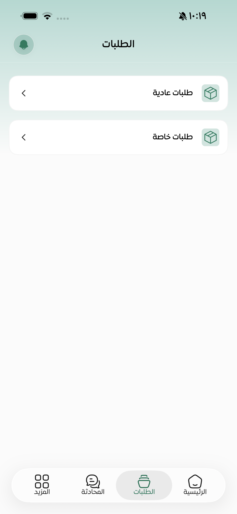
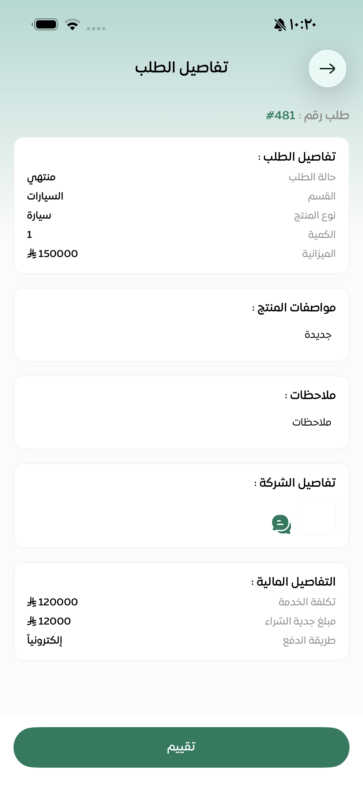
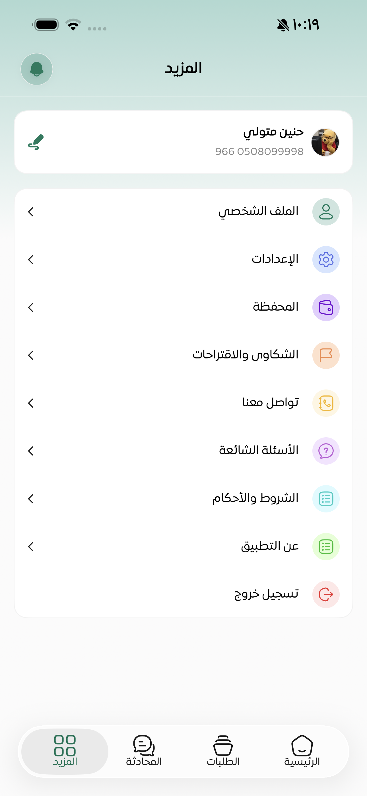

# Esterad

**Esterad** is an iOS app built with Swift and UIKit. It brings shopping and related services together, with tools to browse products and companies, place requests, track orders, and contact support.

## Features

- Account registration, sign-in, and password recovery
- Home screen with categories, products, and company listings
- Product and company details
- Special requests and order tracking
- In-app payments and wallet
- Chat and push notifications
- Profile and account settings
- Arabic and English localization

## Tech Stack

- Swift and UIKit, with Storyboards and XIB files
- Firebase services
- Alamofire and Socket.IO
- Google Maps, Kingfisher, and Lottie
- Swift Package Manager

## Run the App

1. Install Xcode on macOS.
2. Open `Esterad.xcodeproj`.
3. Wait for Xcode to resolve the Swift packages.
4. Select the `Esterad` scheme and an iPhone simulator, then click **Run**.

Some app services may require Firebase configuration, credentials, or access provided by the project owner. Keep private credentials out of the repository.

## Screenshots

### Home

### Categories and listings

| Companies | Products |
|:---:|:---:|
|  |  |

### Orders and product details

| Orders | Order details | Product details |
|:---:|:---:|:---:|
|  |  |  |

### Profile

## Project Structure

- `Esterad/App` — app screens and features
- `Esterad/Shared` — reusable views and helpers
- `Esterad/Resources` — images, colors, fonts, and animations
- `Esterad/Localization` — language support
- `Esterad/Validation` — input validation
